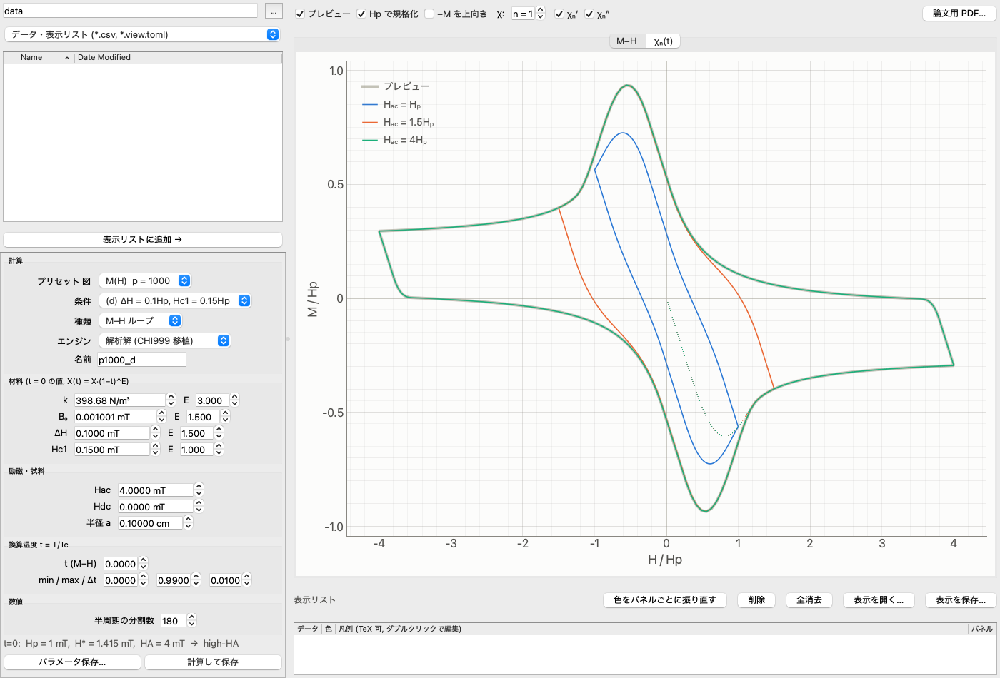
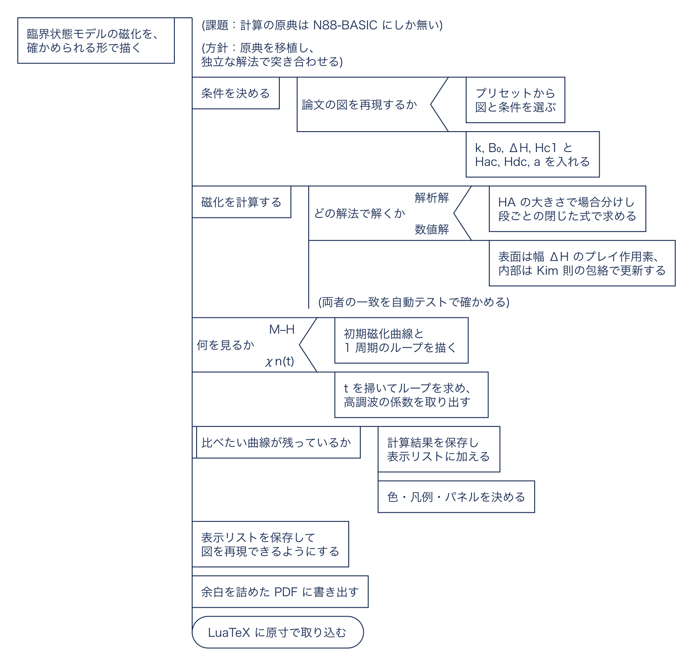

# mh-curve

修正 Kim–Anderson モデル（表面障壁 ΔH と下部臨界磁場 Hc1 を含む臨界状態モデル）で、無限長円柱の第二種超伝導体の **M–H ループ**と**高調波交流磁化率 χₙ(t)** を計算し、比べ、論文用の図に書き出す GUI アプリです。1990 年代の N88-BASIC プログラム（CHI999）の解析解を Python に移植し、独立に書いた数値解と突き合わせて検証しています。

[](https://opensource.org/licenses/MIT)



## 考え方

何が課題で、それをどう解いているかを PAD（問題分析図）で示します。各段の詳細は下の各節を参照してください。



<sub>図の元は [`docs/pad/concept.spd`](docs/pad/concept.spd)。[padkit](https://github.com/mashi727/padkit) で検査・描画しています。</sub>

## 導入と起動

```sh
uv sync
uv run mh-curve            # 前回のデータフォルダ（初回は ./data）を開く
uv run mh-curve path/to/dir
uv run pytest              # 解析解と数値解の一致などを検証
```

`uv tool install --editable .` で `mh-curve` コマンドとして導入できます（`--editable` なら、ソースの変更がそのまま反映されます）。

### Windows 版

[Releases](https://github.com/mashi727/mh-curve/releases) から `mh-curve-windows-x64.zip` を取得し、展開して `mh-curve.exe` を起動してください。Python のインストールは不要です。

ビルドは `.github/workflows/build-windows.yml` が行います。`windows-latest` 上でテストを流し、PyInstaller（onedir 形式）でビルドし、exe が 15 秒間落ちずに動くことを確かめてから zip にします。`v*` タグの push でリリースに添付されます。

## 画面

| 位置 | 内容 |
|---|---|
| 左上 | データフォルダのツリー。フィルタは「データ・表示リスト」「パラメータ」「すべて」。CSV を選ぶと灰色の細い破線で一時表示し、ダブルクリック・ドラッグ・「表示リストに追加 →」で表示リストに入れる。`.toml` を選ぶとパラメータを入力欄に読み込み、`.view.toml` を選ぶと表示リストを復元する |
| 左下 | パラメータ。「プリセット 図／条件」の 2 段で、M(H) の p = 1000, 10, 0.1 それぞれの (a)–(d)（ΔH = 0 / 0.1Hp、Hc1 = 0 / 0.15Hp の組合せ）と、χₙ(t) の薄膜の例を呼び出せる。M(H) のプリセットはどれも Hdc = 0、Hac = 4Hp で、Hp = 1 mT に取っているので mT の軸がそのまま H/Hp, M/Hp になる。既定は p = 1000 の (d)。「計算して保存」で `名前.csv` と `名前.toml` を書き出し、表示リストに加える |
| 右上 | M–H と χₙ(t) のタブ。**プレビュー**（灰色の太い帯）は、左のパラメータ欄の今の値で計算した結果で、値を変えるたびに描き直される（保存はしない）。起動直後（表示リストが空のとき）は、既定条件の Hac = Hp, 1.5Hp, 4Hp の 3 本を見本として描く。表示リストのパネル (a), (b), … ごとにグラフを分ける。「Hp で規格化」（既定オン）で M–H の軸を H/Hp, M/Hp にする |
| 右下 | **表示リスト**。1 行が 1 本の曲線 |

「表示 → 色のモード」で、ライト（既定）・ダーク・システムに合わせる を選べます（論文用 PDF は常にライト）。

### 表示リスト

- チェックで表示・非表示を切り替える。行のドラッグで描画順と凡例順を変え、Delete で外す。
- 色はリストに入った時点で固定する（パレットの空き番を固定順に割り当て、8 本を超えると破線にする）。ほかの曲線を外しても色は変わらない。色見本のクリックで変更できる。「色をパネルごとに振り直す」を押したときだけ、各パネル内の順番で色を割り当て直す。
- 凡例はダブルクリックで編集する。TeX 記法（`$H_\mathrm{ac} = 4H_\mathrm{p}$` など）が使え、PDF では matplotlib の mathtext で組まれる。画面上は下付き・ギリシャ文字に簡易変換して表示する。
- パネル列（a–h）で、その曲線を描くパネルを決める。
- 「表示を保存…」で `名前.view.toml` に保存する（データは表示リストのファイルからの相対パスで記録）。ツリーで選ぶか「表示を開く…」で、同じ図を再現できる。論文用 PDF の設定もこのファイルに入る。

### 論文用 PDF

- 表示リストのパネルごとに 1 枚の図にまとめる。配置は縦一列・横一列・2 列の格子から選び、2 枚以上なら (a), (b), … を右上に入れる。幅は図全体の幅、縦横比はパネル 1 枚の比。
- 幅のプリセットは片段 86 mm／全幅 178 mm。文字サイズの既定は 8 pt、フォントの既定は STIX Two（Times 系）で、TrueType として埋め込まれる。データは枠の 90% を占める（画面と同じ）。
- 余白を切り詰めるため、PDF の実寸は指定幅よりやや狭くなる。LuaTeX では**原寸のまま** `\includegraphics{figures/xxx.pdf}` で取り込むこと。`width=\columnwidth` で拡大すると文字も拡大される。雛形は出力時にクリップボードへコピーされる。

## 計算エンジン

| エンジン | 内容 |
|---|---|
| 解析解（CHI999 移植） | `analytic.py`。HA の大きさ（low / medium / high）と HB で場合分けし、段ごとの閉じた式で ⟨B⟩ を求める。原典の各ステージ（`*MED1D1`, `*LOW1I4` …）を同名メソッドとして、式をそのまま移植している |
| 数値解 | `numeric.py`。表面は Dunn–Hlawiczka の実効磁場 H_eff = H − sgn(H)Hc1 − sgn(dH/dt)ΔH を幅 ΔH のプレイ作用素として、内部は Kim 則 J_c = k/(B₀+\|B\|) の臨界プロファイルの包絡として更新する。任意の磁場履歴（マイナーループなど）に使える |

`tests/test_engines.py` では、B0／low／medium／high の 4 領域、Hdc ≠ 0 の全分岐、Hac ≤ ΔH の完全捕捉を含む 46 条件で、両エンジンの M(H) が Hac の 2×10⁻⁴ 以内で一致することを確かめています。p = 0.1, 10, 1000 の M(H) は、公表済みの計算曲線から読み取った飽和値・ピーク値とも照合しています。

χₙ は M(ωt) = Hac Σ (χₙ′ cos nωt + χₙ″ sin nωt) の係数で、1 周期を 360 分割した台形則で求めます。

### 原典の BASIC からの変更点

原典のプログラムはこのリポジトリには含めていません。

**物理の修正（1 件）**: Hac ≤ ΔH かつ HA > Hc1 + ΔH のとき、降下側の磁場は HA − 2ΔH まで下がらないので、磁束は 1 周期を通して完全に捕捉され、⟨B⟩ = B(HA) で一定になる（Dunn–Hlawiczka の条件）。原典はこの場合を持たず、増加側の別の分岐へ飛んで、実際には存在しない磁束分布で計算していた。χₙ(t) の薄膜の例では 0.59 < t < 0.66 で χₙ″ が最大 0.057 跳ねていたが、修正後は 0 になる（`analytic.py` の `trapped`）。

**物理を変えない変更**:

- 原典は `H(I)` の磁化を `SY(I+1)` に格納しており、ファイル保存時に H と M が 1 点ずれていた。ここでは同じ添字に格納している。
- 原典の M–H 保存は M1 点までしか書かず、ループ最後の 1/4 周が欠けていた。ここでは全点を保存する。
- すべてのループに周期末の上限を付けた（原典には添字が範囲を超えうる箇所があった）。
- 温度依存は原典と同じく X(t) = X(0)(1 − t)^E。M–H も任意の t で計算できる。

## ファイル形式

**パラメータ (`*.toml`)** — 将来のバッチ処理の入力にも使う想定です。

```toml
kind = "chi"           # "mh" | "chi"
engine = "analytic"    # "analytic" | "numeric"
name = "chi_film"

[material]   # t = 0 の値。X(t) = X * (1 - t)^E
k = 250.0      # N/m^3   Jc(B) = k/(B0+|B|)
b0 = 1.0       # mT
dh = 0.5       # mT
hc1 = 0.0      # mT
[exponents]
k = 3.0
b0 = 1.5
dh = 1.5
hc1 = 1.0
[excitation]
hac = 0.1      # mT
hdc = 0.03     # mT
[sample]
a = 0.1        # cm
[temperature]
t = 0.0        # M-H はこの t で計算する
tmin = 0.0     # chi_n(t) の掃引範囲
tmax = 0.99
tstep = 0.01
[numerics]
n_half = 180   # 半周期の分割数
```

**データ (`*.csv`)** — 先頭の `# key = value` 行に計算条件をすべて記録し、その後に CSV の表が続きます。numpy・pandas（`comment="#"`）・pgfplots でそのまま読めます。

- M–H: `branch,theta_deg,H_mT,M_mT`（`branch` は `init` が初期磁化曲線、`loop` が 1 周期）。ヘッダに Hp、H*、領域、χ₁…χ₇ も記録する。
- χₙ(t): `t,chi1_re,chi1_im,…,chi7_re,chi7_im`。

**表示リスト (`*.view.toml`)** — 曲線ごとのデータファイル（相対パス）・凡例・色・パネル・表示の有無と、表示の切り替え、論文用 PDF の設定。

## 参考文献

- Y. B. Kim, C. F. Hempstead, and A. R. Strnad, Phys. Rev. Lett. **9**, 306 (1962); Phys. Rev. **129**, 528 (1963).
- P. W. Anderson, Phys. Rev. Lett. **9**, 309 (1962).
- C. P. Bean, Rev. Mod. Phys. **36**, 31 (1964).
- W. I. Dunn and P. Hlawiczka, Brit. J. Appl. Phys. **1**, 1469 (1968).
- D. X. Chen and R. B. Goldfarb, J. Appl. Phys. **66**, 2489 (1989).

## ライセンス

[MIT](LICENSE)
